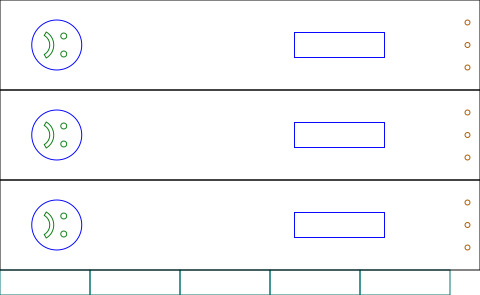

# Slapstick

**[← All projects](https://gernreich.github.io/)**

**[Read the writeup](https://gernreich.github.io/slapstick/)**

**[Turn it in 3D](https://gernreich.github.io/slapstick/slapstick-3d.html)**

> **This is a dangerous object. It can injure you, and it can injure anyone
> near you.** A slapstick is a lever nearly half a metre long: two 9 mm slats
> swung hard and stopped dead against each other. Gripped at the engraved
> rectangle the tip travels between 2.7 and 5.6 times as fast as your hand,
> and the gap where the slats meet closes on whatever is in it. It is loud on
> purpose, and loud enough to startle anyone nearby. Keep fingers out of the
> clap, keep people out of the swing, and mind ears as well as heads —
> [Handle it with care](#handle-it-with-care) has the rest.

Two long slats joined at one end. Swing it and the free ends clap together with a crack
far louder than the effort suggests — the sound effect that gave stage comedy its name.
This one carries a face on each side, from the **comedy and tragedy masks**: laughing on
one, weeping on the other. Output is millimetre-true — `1 user unit = 1 mm` with a
physical `width`/`height` — so it prints and cuts at real size.

<table>
<tr>
<td align="center"><a href="slapstick_happy.svg"></a></td>
</tr>
<tr>
<td align="center"><sub>slapstick_happy.svg · comedy · 480 × 295 mm</sub></td>
</tr>
<tr>
<td align="center"><a href="slapstick_sad.svg"></a></td>
</tr>
<tr>
<td align="center"><sub>slapstick_sad.svg · tragedy · 480 × 295 mm</sub></td>
</tr>
</table>

*One sheet per side. Click either to download it — these are display renderings, since the
cut files draw a hairline on no background that a browser shows almost invisibly. Green, orange and cyan are darkened in the picture — at full strength they are too pale to read against a light ground. The cut file keeps the exact values.*

Built for **[LaserMadeMusic](https://www.youtube.com/@LaserMadeMusic)**, where the cutting
and assembly are shown.

**[The rest of the build files](https://gernreich.github.io/lasermademusic.html)** — every instrument,
generator and tool, indexed.

**[Download everything as a ZIP](https://github.com/Gernreich/slapstick/archive/refs/heads/main.zip)**

## Colour is the cut order

**Blue is not a cut.** The rest run first to last:

| | Colour | What it is | When |
|---|---|---|---|
| | blue `#0000ff` | face outline and glue rectangle | **engrave — never cut** |
| 1 | green `#00ff00` | eyes and mouth | first cut |
| 2 | orange `#ff8000` | the rope-hinge holes — nine, three per paddle | second cut |
| 3 | cyan `#00ffff` | the five handle strips | third cut |
| 4 | black `#000000` | the three paddle outlines | last cut |

Outlines last, because once a cut frees a part anything still to be cut inside it can
move. A per-colour job silently skips any colour you leave unmapped.

## What is on each sheet

Drawn by `slapstick.rs` from its parameters (by hand in Inkscape until 2026-11-08).
The two sheets differ only in the mouth:

| Part | Count | Size |
|---|---|---|
| Paddle blank | 3 | 480 × 90 mm |
| Handle strip | 5 | 90 × 25 mm |
| Face outline, engraved | 3 | 50 mm circle, centred 56.75 mm from the left end |
| Glue rectangle, engraved | 3 | 90 × 25 mm, starting 294.5 mm from the left end |
| Eyes | 6 | 6 mm each |
| Mouth | 3 | 9.5 × 26 mm |
| Rope-hinge holes | 9 | 5 mm, 12.5 mm from the right end, 22.5 mm apart |

The face reads sideways on the sheet because the paddle is laid out along its length; it
comes upright when the slapstick is held to swing.

## Building it

1. **Glue three paddles one on top of the other** — three for comedy, three for tragedy.
   Each laminate is one slat. **Make sure both sides have the face out.** That works
   because the face is symmetric about the paddle's long centreline, so turning a paddle
   over leaves it reading the same.
2. **Glue four short strips into a block, twice.** Each slat gets a handle of its
   own, 12 mm thick. Each sheet carries five strips, so one from each sheet is a
   spare.
3. **Glue each handle over the engraved rectangle on its slat's outer face**, which is
   there to show you where. It is a mark, not a recess — engraving removes very little
   material.
4. **Lace a rope through the three holes at the far end** to join the two slats. The
   rope is the hinge — no pin, no hardware. Length and thickness are yours; the holes
   are 5 mm, which sets the ceiling.

**Where the handle sits decides how fast the slats meet.** The free slat turns about the
hinge, so the ratio is tip distance ÷ grip distance. From the hinge, the tip is 467.5 mm and
the engraved handle runs 83–173 mm — so the tip moves **5.6× to 2.7×** your hand speed
depending where you hold it. Sliding your hand along the existing 90 mm handle already
spans a factor of two; moving the rectangle closer to the hinge before cutting buys more,
at the cost of needing a harder pull and being twitchier to aim.

## Before you cut

**Cut it in 3 mm Baltic birch plywood** — what this is built in. Three paddle blanks make
a **9 mm** slat and four handle strips make each slat's **12 mm** handle. A slapstick's job is to be
swung hard and stopped abruptly, so change the stock and you change how stiff each slat
is.

## Handle it with care

**Unlike the other two, this one is not spun — it is swung and stopped.** Everything you
put into it arrives at once, at the moment the slats meet.

**Mass.** A slat is three 3 mm blanks laminated: **263g**, and the pair with their handles is
about **563g** in Baltic birch at 680 kg/m³. That is five times a three-ply buzz disc and
ten times a three-ply bullroarer, on a lever nearly half a metre long.

**Speed.** The free slat turns about the rope hinge and its tip is **467.5 mm** out. Gripped
at the engraved rectangle the tip moves between **2.7 and 5.6 times** as fast as your
hand, and moving your grip closer to the hinge raises that.

**The clap.** Two 9 mm slats close on each other along their whole length and nothing
limits how hard. Whatever is in the gap is in a lever's jaws, and fingers are the obvious
candidate.

So: **keep fingers out of the clap and people out of the swing.** It is loud on purpose —
that is the instrument, not a side effect — so mind ears as well as heads, including your
own at arm's length. Check the rope and its knots before each session: the hinge is the
only thing holding the free slat on.

## Files

| | |
|---|---|
| `slapstick_happy.svg` · `slapstick_sad.svg` | one sheet per side |
| `previews/` | display renderings — **not** cut files |
| `slapstick-3d.html` | the 3D view, assembled from the cut files — drag to turn |
| `slapstick.rs` | draws both cut sheets and writes the SolidCraft design from the parameters below: `cargo build --release`, then `target/release/slapstick` |
| `solidcraft/` · `step/` | the SolidCraft design and the STEP file built from it (below) |
| `viewer.rs` | builds `slapstick-3d.html` from the cut files, with the turn3d module in lasermade-tools: `cargo build --release`, then `target/release/viewer` |
| `Cargo.toml` · `Cargo.lock` | the Rust package for `slapstick.rs` and `viewer.rs`; it expects the lasermade-tools checkout beside this one |
| `.repro` | how every shipped drawing and page is reproduced |
| `index.md` · `index.html` | the published page; the markdown is the source |

Released under [CC0 1.0](LICENSE).

## Changing it

Every size is a parameter, and each is a flag on `slapstick.rs` (`--handle-x=280`, a
dash for each underscore) and a parameter of the same name in the SolidCraft design:

| parameter | default | what it is |
|---|---|---|
| `ply` | 3 mm | the ply: every part |
| `length` | 480 mm | a paddle, hinge end to tip |
| `width` | 90 mm | a paddle, across |
| `face_x` | 56.75 mm | the face's centre from the tip end |
| `face_d` | 50 mm | the engraved face circle |
| `eye_d` | 6 mm | an eye |
| `eye_dx` | 7 mm | the eyes from the face's centre, toward the hinge |
| `eye_dy` | 9 mm | each eye from the centreline |
| `mouth_ro` | 15 mm | the mouth's outer arc, radius |
| `mouth_ri` | 11 mm | the mouth's inner arc, radius |
| `mouth_span` | 120° | the angle the mouth's arcs span |
| `mouth_dx` | 2.5 mm | the smile's arc centre from the face's centre, toward the hinge |
| `hinge_d` | 5 mm | a rope hole |
| `hinge_inset` | 12.5 mm | the rope holes from the hinge end |
| `hinge_pitch` | 22.5 mm | rope hole to rope hole |
| `handle_x` | 294.5 mm | the handle's near end from the tip end |
| `handle_len` | 90 mm | the handle and each strip, long |
| `handle_w` | 25 mm | the handle and each strip, across |

`target/release/slapstick` prints the masses, the lever ratios and a validation block:
the eyes and mouth inside the face, the mouth a band, the eyes clear of it, the face clear
of the handle, at least a hole's width of ply round the rope holes, the handle short of
them, and each sheet on the 600 × 305 mm bed. `--out=DIR` writes the sheets elsewhere and
`--no-write` only checks.

What the hand drawing had that this does not: paddles 479.71 by 89.71 mm (Inkscape's
size for a 480 by 90 rectangle less its stroke), two hinge holes per paddle drawn 4.94 mm
across and 0.12 mm in from the third, and every part 0.008 mm in from the sheet's corner.

## SolidCraft design and STEP file

`solidcraft/slapstick-comedy-and-tragedy.solidcraft.json` is the slapstick as a
parametric SolidCraft design, written by

```
target/release/slapstick --no-write --solidcraft=solidcraft
```

and SolidCraft builds the design file and the STEP file from it:

```
cd solidcraft
solidcraft-cli run slapstick-comedy-and-tragedy.solidcraft.json --save slapstick-comedy-and-tragedy.sc --out ../step/slapstick-comedy-and-tragedy.step --quiet
../../lasermade-tools/target/release/sc-slim slapstick-comedy-and-tragedy.sc
```

It is one body per part, 14 in all: the comedy slat's three paddles on the bench, the
tragedy slat's three on them, closed, and a four-strip handle block on each slat's outer
face. Every size follows the parameters above. The eyes, mouth and rope holes are cut
through; engraving has no depth and is left out. Built, each body's volume matches the
generator's to within 2e-6, and with nine parameters moved at once the design builds the
same bodies as the generator does at those values. `.repro` checks all three files.
The STEP file used to be written from the 3D view by `step-export`; since 2026-11-08
SolidCraft builds it.

The files:

- `solidcraft/slapstick-comedy-and-tragedy.solidcraft.json`
- `solidcraft/slapstick-comedy-and-tragedy.sc`
- `step/slapstick-comedy-and-tragedy.step`

## Credits

Made by Michael Gernreich with [Claude](https://www.anthropic.com/claude) (Anthropic), working in Claude Code, which co-wrote the code and the documentation. Commits Claude made carry a `Co-Authored-By: Claude` line.
